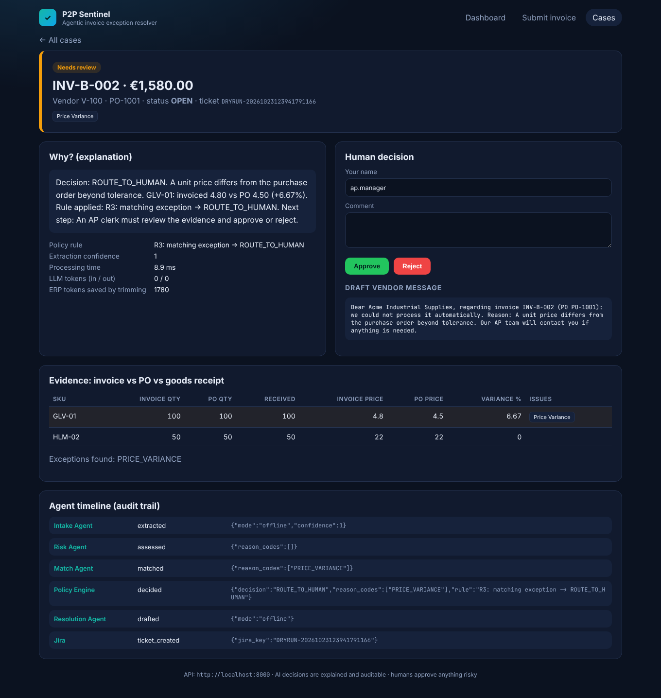

# P2P Sentinel — Agentic Invoice Exception Resolver

Reference application for the **AI Full-Stack Agentic Zone** training.
Every invoice is extracted, three-way matched against the ERP, risk-checked,
decided by a deterministic policy, explained by an agent and — when risky —
routed to a human with a full evidence trail.



- Spec (single source of truth): [`docs/SPEC.md`](docs/SPEC.md)
- Architecture diagrams: [`docs/architecture.md`](docs/architecture.md)
- Decisions: [`docs/adr/`](docs/adr) · Responsible AI: [`docs/responsible-ai.md`](docs/responsible-ai.md) · Ops: [`docs/runbook.md`](docs/runbook.md)

## Quickstart (local, zero cost, no API key)

```bash
cd reference-app
python -m venv .venv
source .venv/bin/activate            # Windows PowerShell: .venv\Scripts\Activate.ps1
pip install -r requirements.txt -r requirements-dev.txt
cp .env.example .env                 # Windows: copy .env.example .env

# terminal 1 - mock ERP
uvicorn mock_erp.main:app --reload --port 8001
# terminal 2 - API  (Swagger UI at http://localhost:8000/docs)
uvicorn backend.app.main:app --reload --port 8000
# terminal 3 - UI   (http://localhost:5173)
cd frontend && npm install && npm run dev
```

Try it: open the UI → **Submit invoice** → click the sample chips in order A → H.

```bash
# or from the command line
curl -X POST http://localhost:8000/api/invoices/samples/inv_b_price_variance
```

## Quality gates

```bash
pytest                                 # 63 unit + integration tests
python -m evals.run_evals              # golden set: 8/8 expected
bash scripts/run_quality_gates.sh      # ruff, pytest+coverage, evals, pip-audit, bandit -> docs/test-evidence/
cd frontend && npm test && npm run build
# E2E (needs ERP + API + UI running):
cd frontend && npx playwright test
```

## Switch on a real LLM

`LLM_PROVIDER` in `.env`:

| Value | Also set | Notes |
|---|---|---|
| `offline` (default) | — | Deterministic stand-ins. Tests and evals use this. |
| `openai` | `OPENAI_API_KEY`, `LLM_MODEL=gpt-4.1-mini` | OpenAI Responses API; SDK tracing visible on platform.openai.com |
| `azure` | `AZURE_OPENAI_API_KEY`, `AZURE_OPENAI_ENDPOINT`, `AZURE_OPENAI_DEPLOYMENT` | Chat Completions against your Azure OpenAI deployment |
| `anthropic` | `ANTHROPIC_API_KEY`, `LLM_MODEL=litellm/anthropic/claude-haiku-5-5` | `pip install "openai-agents[litellm]"` first |

Decisions do not change with the model (ADR-0002); only extraction and
explanations do. Re-run `python -m evals.run_evals` after switching.

## Full stack in containers

```bash
docker compose up --build     # UI :8080 · API :8000 · ERP :8001 · Postgres :5432
```

## Project map → the 9 layers of a production agentic system

| # | Layer | Where in this repo |
|---|---|---|
| 1 | **Experience** (UI, HITL) | `frontend/src/pages/*` — dashboard, evidence table, approve/reject |
| 2 | **API & Gateway** | `backend/app/main.py`, `backend/app/api/routes.py` — contracts, validation, CORS, health/readiness |
| 3 | **Orchestration** | `backend/app/agents/pipeline.py` — hybrid workflow, parallel fan-out, fallbacks |
| 4 | **Agents & Reasoning** | `backend/app/agents/*_agent.py`, `model_provider.py` — instructions, structured outputs, model choice |
| 5 | **Tools & Integration** | `backend/app/agents/tools.py`, `integrations/erp_client.py`, `integrations/jira_client.py`, `mcp_servers/erp_mcp.py` |
| 6 | **Context & Memory** | `agents/context.py` (`CaseContext`), fact blocks in `pipeline.py`, ERP trim layer |
| 7 | **Data** | `backend/app/models.py`, `db.py` — invoices, cases, append-only audit events |
| 8 | **Guardrails & Governance** | `agents/guardrails.py`, `domain/policy.py`, `domain/risk.py`, `docs/responsible-ai.md` |
| 9 | **Observability & Evaluation** | `observability.py`, `evals/`, `tests/`, `docs/runbook.md`, `docs/test-evidence/` |

## Folder guide

```
backend/app/
  config.py            typed settings from env / .env
  db.py, models.py     SQLAlchemy engine + tables
  schemas.py           Pydantic contracts (ReasonCode, Decision, DTOs)
  domain/              deterministic engines: matching, risk, policy  (100% tested)
  integrations/        ERP client with trim layer, Jira REST v3 client
  agents/              OpenAI Agents SDK: context, tools, guardrails, agents, pipeline
  explain.py           reason codes -> plain English, evidence
  case_service.py      persist case, audit, ticket, HITL, metrics
  api/                 FastAPI routes + dependencies
  observability.py     JSON logs + Azure Monitor OpenTelemetry
mock_erp/              SAP-OData-style mock ERP (verbose on purpose)
mcp_servers/erp_mcp.py MCP server so Claude Code can query the ERP
data/sample_invoices/  8 scenario invoices (A..H)
evals/                 golden set + harness
tests/                 unit/ and integration/
frontend/              React + Vite + TypeScript UI, nginx Dockerfile, Playwright e2e
docker/, docker-compose.yml
docs/                  SPEC, architecture, ADRs, RAI, runbook, test evidence, screenshots
```

## Deploy to Azure

```bash
az login --use-device-code
source infra/azure/env.sh                 # resource names; override any with export
bash infra/azure/deploy.sh                # RG, Log Analytics, App Insights, ACR (cloud build), Container Apps, SWA
USE_POSTGRES=1 bash infra/azure/deploy.sh # same, plus PostgreSQL Flexible Server (B1ms)
bash infra/azure/github-oidc.sh <owner> <repo>   # Entra app registration + federated credential for keyless CI/CD
bash infra/azure/teardown.sh              # delete the resource group (asks for confirmation)
```

CI/CD workflows live at the repository root in `.github/workflows/reference-app-ci.yml` and
`reference-app-deploy.yml`. An optional AKS manifest is in `infra/k8s/api.yaml`.

## Claude Code setup in this repo

`CLAUDE.md`, `.claude/` (settings with permissions and hooks, skills, subagents, rules) and `.mcp.json`
are the same files as `../starter-kit/`. The hooks need `python3` on PATH (on Windows change it to `python`
in `.claude/settings.json`). Every file Claude writes is logged to `.ai-trace/ledger.jsonl` (git-ignored).
