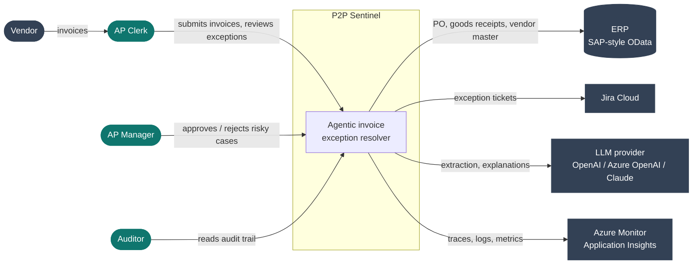
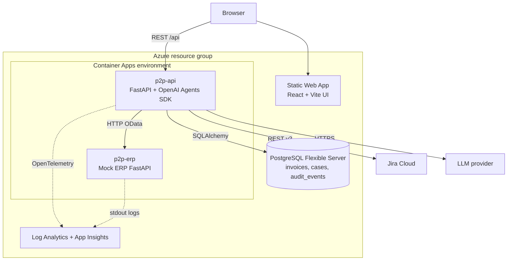
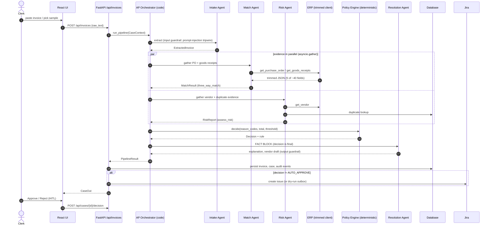
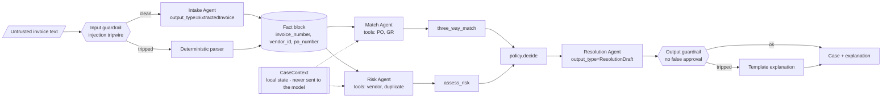
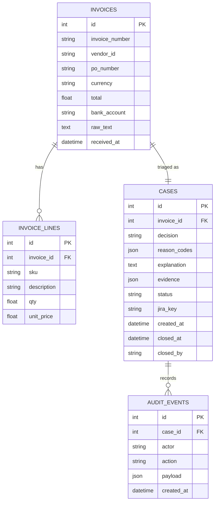

# P2P Sentinel — Architecture

> All diagrams are Mermaid: they render on GitHub, in VS Code (Markdown Preview
> Mermaid Support extension) and at https://mermaid.live.

## 1. System context (C4 level 1)

## 2. Containers (C4 level 2)

Locally the same containers run with `docker compose up --build`
(PostgreSQL in a container) or as plain processes with SQLite.

## 3. Sequence — one invoice

## 4. Agent topology and context flow

What each agent sees:

| Agent | Receives | Returns to orchestrator |
|---|---|---|
| Intake | raw invoice text (after the guardrail) | `ExtractedInvoice` |
| Match | 3-field fact block | one sentence; engine output is `MatchResult` |
| Risk | 3-field fact block | one sentence; engine output is `RiskReport` |
| Resolution | decision + reason codes + evidence | `ResolutionDraft` |

No agent receives another agent's transcript — only typed results flow back.

## 5. Data model

